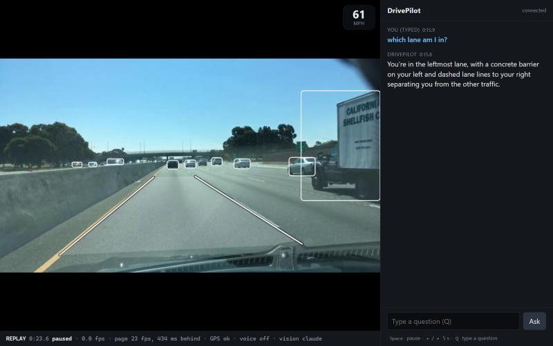
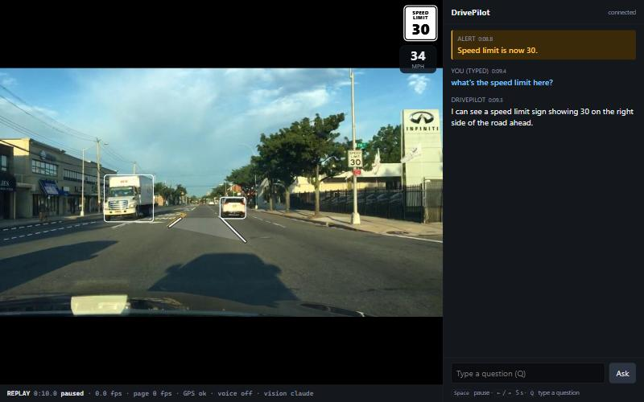
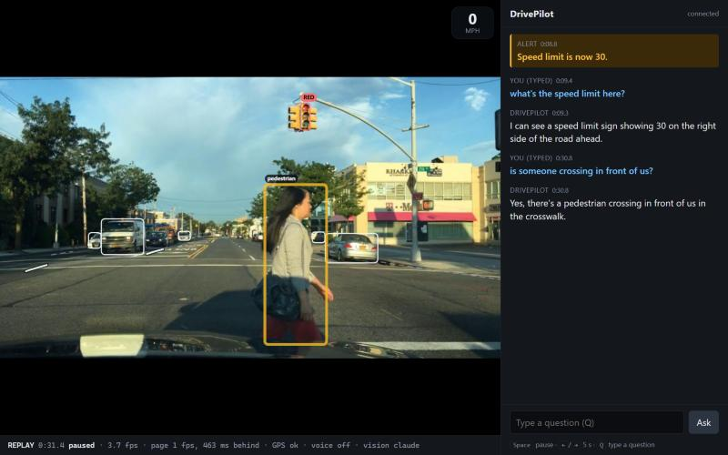
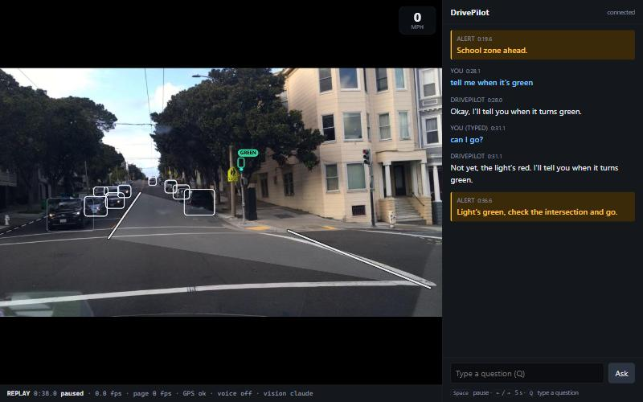

# DrivePilot: dashcam voice co-pilot (Banana Hacks 2026)

A phone on the dash streams video to a laptop. The laptop watches the road, answers spoken questions in
about 1–2 seconds, and speaks up on its own when something matters: who goes next at a 4-way stop, which lane
to be in, which roundabout exit, what a sign means, whether you can park here.

- **Local and instant:** YOLO26s + ByteTrack on the GPU track every car. Right-of-way questions are answered
  from tracker state with no cloud call.
- **Model only when needed:** sign, parking, traffic-light, lane and road questions go to a vision-language
  model (Claude Haiku by default; Gemini Flash or a local Ollama model via `config.yaml`) with the latest frames.
- **Navigation:** Mapbox route + phone GPS for lane guidance, roundabout exits and route questions.
- **V2:** an overlay screen (car badges for the 4-way stop, the light's state, pedestrians, the navigation banner
  with lanes, speed and speed limit, our lane), "what was that sign?" with the frame it answered from, the object
  an answer is about pulsing on screen, "find me a parking spot", pedestrian and cyclist warnings ("Pedestrian
  stepping into the road on your right."), YOLOPv2 lane detection (which lane we're in, for lane guidance) with a
  drift warning ("Careful, you're drifting right." above 25 mph), and a fine-tuned US sign detector ("Speed limit
  is now 35.", "School zone ahead."). All of it runs at once on the laptop GPU within the latency targets
  (PROGRESS.md). Parking spots and drift warnings are below their accuracy bars on public footage and need our own
  drives to tune (PROGRESS.md "Known issues").

See [PLAN.md](PLAN.md) for the full design, [V2_BUILD_PLAN.md](V2_BUILD_PLAN.md) for V2 and
[PROGRESS.md](PROGRESS.md) for current status, measurements and known limits.

## Screenshots

The V2 screen on public BDD100K replays (the video with its overlays on the left, the conversation on the right):

| | |
| --- | --- |
|  |  |
| Highway: our lane (YOLOPv2), tracked cars, speed from GPS, "which lane am I in?" | A SPEED LIMIT 30 sign: the alert, the limit badge, and the answer |
|  |  |
| At a red light: the person crossing pulses because the answer is about her | "Tell me when it's green" and the alert when it turns |

## Requirements

- Windows 11 with an NVIDIA GPU and a recent driver (developed on an RTX 4050 Laptop GPU, 6 GB)
- [uv](https://docs.astral.sh/uv/) (installs Python 3.11 for you) and git
- For live camera mode: an Android phone with USB debugging, plus [scrcpy](https://github.com/Genymobile/scrcpy)
  (it bundles `adb`)
- API keys: Anthropic (vision model) and Mapbox (navigation). Without keys the app still runs. Local answers
  work, and the cloud features say that they are not available.

## Setup

```powershell
git clone https://github.com/NMGit-hub/DrivePilotBananaHacks2026.git
cd DrivePilotBananaHacks2026

# 1. Python 3.11 virtual environment
uv python install 3.11
uv venv --python 3.11 .venv

# 2. Dependencies (CUDA 12.6 PyTorch comes from the PyTorch index listed in requirements.txt)
uv pip install --python .venv/Scripts/python.exe -r requirements.txt --index-strategy unsafe-best-match

# 3. Check that the GPU is actually used (PyTorch, YOLO26s and CTranslate2)
.venv/Scripts/python scripts/check_gpu.py

# 4. Build the TensorRT engine for the detector (one-time per machine, ~10 min; uses its own build venv)
.venv/Scripts/python scripts/build_engine.py

# 5. API keys
copy .env.example .env
#    then edit .env and fill in ANTHROPIC_API_KEY and MAPBOX_ACCESS_TOKEN
```

Without uv: create a Python 3.11 venv any way you like, then run
`python -m pip install -r requirements.txt` (pip reads the extra PyTorch index from the file).
`requirements-lock.txt` pins every transitive package of the verified environment.

Model weights (YOLO26s, the speech-to-text model) download into `models/` on first run. The Piper voice
(`en_US-lessac-medium.onnx` and its `.onnx.json`, from the `rhasspy/piper-voices` repository on Hugging Face)
goes in `models/piper/` (see `voice.tts.voice` in config.yaml). The wake-word model is in the repo.

## Running

```powershell
# Replay a recorded drive (optionally with its GPX track), with voice and the screen:
.venv/Scripts/python -m app --video data/videos/dev/red_light_turns_green_sf__b97b9ee8-612c36ef.mov

# Live: the phone camera over USB (scrcpy), GPS from the phone's browser
adb reverse tcp:8000 tcp:8000
.venv/Scripts/python -m app --camera
```

- The screen is at <http://localhost:8000/>: the video with its overlays (each frame and its boxes arrive in
  one message), the navigation banner, speed and speed limit, and the conversation as text. The plain V1 screen
  is at <http://localhost:8000/v1> (or `ui.overlays: false`). Hotkeys: **space** pause, **←/→** skip 5 s,
  **Q** type a question.
- Say **"Hey DrivePilot"**, then the question ("who got here first?", "which lane for 520 east?",
  "I'm going to Redmond Town Center", "tell me when it's green", "what was that sign?", "help me find a
  parking spot", "quiet mode", "repeat that", "stop").
- On the phone, open <http://localhost:8000/gps> and tap Start: it sends the location once a second.
- Options: `--no-voice` (typed questions only), `--no-audio` (answers on the screen only), `--gpx track.gpx`,
  `--ask "22.5=who got here first?"` (a typed question at a video time), `--exit-at-end`,
  `--set key=value` (any config value), `--print-config`.
- Every run writes a review folder under `runs/`: log, questions, answers, alerts, world events, GPS,
  detections, frames (one a second plus every frame sent to the vision model) and `summary.json` with
  latencies.

For drives: plug the laptop into its own charger and set Windows to **Best performance** power mode.

### Record your own drive (video + GPS) and replay it

1. **Video:** the phone's camera app (OnePlus 12: 0.6x ultrawide, 1080p 30 fps), phone mounted on the
   windshield. Keep the file name (`VID_YYYYMMDD_HHMMSS.mp4`): it holds the start time.
2. **GPS:** the GPSLogger app (Android): log to GPX (1.0 or 1.1), logging interval 1 second, distance filter 0,
   no accuracy filter. Start logging before you press record and stop it after.
3. Drive through at least one full stop (a red light or a stop sign) in the first 3 minutes: that is what the
   timing is matched on (a pull-away from a parking space isn't trusted).
4. Copy the video to `data/videos/own/` and the GPX to `data/gps/`, then run:

   ```powershell
   .venv/Scripts/python scripts/align_gpx.py data/videos/own/VID_20261011_143022.mp4 data/gps/20261011.gpx
   ```

   It prints the start time from the file name (Pacific time; `--tz` to change it) and from the video's
   `creation_time` (and warns if they disagree by more than 2 s), then refines it by matching the first pull-away
   from a stop in the video (ego motion; it builds the perception cache for the first 3 minutes on the GPU) with
   the GPS speed rising, with a confidence. If nothing matches it says so and keeps the timestamp start (±1 s).
   It writes `data/gps/20261011.aligned.gpx` (the original GPX is never changed) and prints the replay command:

   ```powershell
   .venv/Scripts/python -m app --video data/videos/own/VID_20261011_143022.mp4 --gpx data/gps/20261011.aligned.gpx --set video.file.hfov_deg=null
   ```

   `hfov_deg=null` uses the phone's 114° field of view instead of BDD100K's 60°. Options: `--no-refine`
   (timestamps only, no GPU), `--start 2026-10-11T14:30:22.4` (a renamed file), `--search-s 600` (no stop early
   on). On BDD100K clips with a known start moved off by -9..+8 s (`scripts/eval_align.py`), the 6 clips with a
   full stop and pull-away came back within 0.32 s on 52 of 54 tries (2 off by 1.15 s); the others kept the
   timestamp start and said so (nav/align.py has the method).

## Tools

```powershell
.venv/Scripts/python scripts/fetch_dev_clips.py        # download the public dev clips (BDD100K)
.venv/Scripts/python scripts/bench_app.py --silent     # whole app + spoken questions: latencies vs targets
.venv/Scripts/python scripts/bench_pipeline.py         # perception FPS / latency / GPU memory vs targets
.venv/Scripts/python scripts/voice_eval.py             # wake word + Whisper + routing on synthetic voices
.venv/Scripts/python scripts/eval_ego_motion.py        # "are we stopped?" vs hand labels
.venv/Scripts/python scripts/eval_traffic_lights.py    # traffic-light reading vs hand labels
.venv/Scripts/python scripts/ask_model.py --suite eval/model_questions.yaml   # vision model on dev frames
.venv/Scripts/python scripts/fetch_route.py --from 47.6158,-122.2037 --to "Redmond Town Center"
.venv/Scripts/python eval/run_sheet.py                 # the test sheet: every question at its moment, judged
.venv/Scripts/python scripts/cache_perception.py --labels eval/parking_labels.yaml --videos data/videos/parking_lot
.venv/Scripts/python scripts/eval_parking.py           # parking spots vs hand-labeled lot clips (cached perception)
.venv/Scripts/python scripts/eval_pedestrians.py --road  # pedestrian warnings on cached clips (+ YOLOPv2 road)
.venv/Scripts/python scripts/eval_lanes.py cache --clip data/videos/highway/<id>.mov   # YOLOPv2 masks, once
.venv/Scripts/python scripts/eval_lanes.py index       # our lane vs hand-labeled highway frames
.venv/Scripts/python scripts/eval_lanes.py drift       # drift warnings on the highway clips (GPS speed)
.venv/Scripts/python scripts/eval_lanes.py virtual --clip data/videos/highway/<id>.mov   # a warped slow drift
.venv/Scripts/python scripts/find_bdd_clips.py --scene "parking lot" --min-crawl-s 15 --max-mph 15 --fetch 10
.venv/Scripts/python scripts/align_gpx.py data/videos/own/VID_<...>.mp4 data/gps/<track>.gpx   # own drive + GPX: video_start
.venv/Scripts/python scripts/eval_align.py             # align_gpx's refinement vs BDD100K clips with a known start
```

## Configuration

Everything lives in [config.yaml](config.yaml); API keys come from `.env`. The most important settings:

| Setting | Meaning |
| --- | --- |
| `video.source` | `camera` (phone via scrcpy) or `file` (a recorded drive). Same pipeline for both. |
| `video.file.path`, `video.file.gpx_path` | The recorded drive and its optional GPX track (file mode plays at real-time speed). |
| `vision_model` | Which vision-language provider answers scene questions: `claude` (default, Claude Haiku), `gemini`, `ollama` or `mock`. |
| `nav.home` | The address for "take me home". |
| `voice.wakeword.threshold` | Wake-word sensitivity (0.25; lower hears more, with more false wakes). |
| `ui.overlays` | The V2 overlay screen (default) or the plain V1 one. |
| `vision.mark_objects` | Number the tracked objects on the frame sent to the model, so its answer can point at one. |
| `parking.*`, `memory.*`, `sign_alerts.*` | V2: the parking spot finder, "what was that sign?", sign alerts. |
| `lanes.*` | V2: YOLOPv2 lane detection (`enabled`, `fps`; weights `models/lanes/yolopv2.pt` from github.com/CAIC-AD/YOLOPv2) and the drift warning (`drift_gap_m`, `min_speed_mps`). |
| `pedestrians.*` | V2: the path zone for pedestrian/cyclist warnings; `road_min_share` uses the lanes model's drivable area. |

## Tests

```powershell
.venv/Scripts/python -m pytest
```

The tests need no camera, microphone or API keys (a few use the GPU and are marked `gpu`).

## Test footage

Your own drives go in `data/videos/` (gitignored). For development the repo uses a few public
[BDD100K](https://bdd-data.berkeley.edu/) validation clips. Those are not committed and are only for tuning.
The submission video uses only our own footage.
